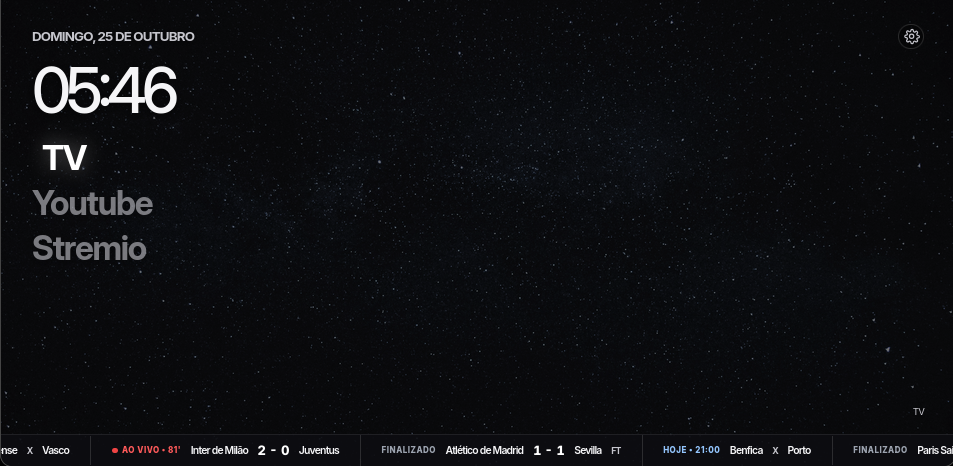

# TVHomeLab

Launcher Android personalizado para TV TCL, desenvolvido com Kotlin, WebView, HTML, CSS e JavaScript.

O TVHomeLab é um projeto experimental que substitui a interface visual padrão da TV por uma home própria, com atalhos para aplicativos, relógio, plano de fundo personalizado, navegação pelo controle remoto e acesso às configurações do Android.

A interface é renderizada localmente dentro de um aplicativo Android nativo. Não depende de um servidor web ou de uma conexão com a internet para exibir a home.


## Objetivos

- Criar uma interface inicial personalizada para a TV.
- Disponibilizar atalhos para aplicativos instalados.
- Permitir navegação por setas e ativação pelo botão Enter do controle remoto.
- Integrar a interface web às funcionalidades nativas do Android.
- Manter o layout independente da lógica de integração com o sistema.
- Iniciar diretamente na home personalizada após a reinicialização da TV.

## Tecnologias

| Tecnologia      | Responsabilidade                                |
| --------------- | ----------------------------------------------- |
| Kotlin          | Activity principal e integração com o Android   |
| Android WebView | Renderização da interface web                   |
| HTML            | Estrutura da home                               |
| CSS             | Layout, plano de fundo, cards e estados de foco |
| JavaScript      | Navegação, seleção e interação com os controles |
| Android SDK     | APIs e ferramentas de desenvolvimento Android   |
| Gradle          | Compilação e geração do APK                     |
| ADB             | Instalação, execução e diagnóstico remoto       |

## Arquitetura

O projeto utiliza uma arquitetura híbrida: um aplicativo Android nativo hospeda uma interface web local.

```text
TVHomeLab
├── Android / Kotlin
│   ├── MainActivity
│   ├── Configuração do WebView
│   ├── Abertura de aplicativos
│   ├── Abertura das configurações
│   └── Ponte JavaScript ↔ Android
│
└── Interface Web
    ├── HTML
    │   └── Estrutura da home
    ├── CSS
    │   └── Layout e identidade visual
    ├── JavaScript
    │   └── Navegação e seleção
    └── Assets
        └── Imagens e plano de fundo
```

O Kotlin cria a Activity e carrega a página local no WebView. O JavaScript controla o comportamento da interface e solicita ações nativas por meio de uma ponte disponibilizada pelo Android.

Essa separação permite alterar o visual da home sem precisar implementar cada elemento como um componente nativo.

## Funcionalidades

### Interface personalizada

- Plano de fundo próprio.
- Sobreposição visual para melhorar o contraste.
- Relógio e data.
- Cards com imagens dos aplicativos.
- Identificação `Caiorossi.dev`.
- Botão de configurações integrado à interface.

### Navegação pelo controle remoto

A interface implementa navegação por teclado para permitir o uso do controle remoto:

- **Direita / baixo:** avança a seleção.
- **Esquerda / cima:** retorna a seleção.
- **Enter / espaço:** ativa o elemento selecionado.

O destaque visual de foco é controlado pelo CSS, enquanto o JavaScript mantém o estado da seleção.

O botão HOME é diferente das setas: sua resolução é responsabilidade do Android e do firmware da TV, não da navegação JavaScript.

### Configurações do Android

O botão de engrenagem utiliza a ponte JavaScript–Kotlin para solicitar a abertura das configurações do sistema.

A chamada `Android.openSettings()` é implementada na Activity por meio de uma interface JavaScript anotada com `@JavascriptInterface`.

O destino solicitado é `Settings.ACTION_SETTINGS`. O comportamento final depende do firmware da TV.

## Ambiente de desenvolvimento

### Dispositivo-alvo

- Fabricante: TCL.
- Plataforma: Android TV.
- Versão do Android: Android 11.
- API: 30.
- Identificador interno observado: `BeyondTV4`.

### Computador

- Sistema operacional: Pop!\_OS.
- Java: 21.
- Gradle: 8.9.
- Android SDK instalado.
- ADB disponível no terminal.

### Identificação do projeto

| Propriedade        | Valor                                       |
| ------------------ | ------------------------------------------- |
| Diretório          | `~/Projetos/TVHomeLab`                      |
| Package            | `br.com.caio.tvhomelab`                     |
| Activity principal | `br.com.caio.tvhomelab.MainActivity`        |
| APK de depuração   | `app/build/outputs/apk/debug/app-debug.apk` |

O caminho do Gradle utilizado no ambiente atual é:

```bash
$HOME/.local/opt/gradle-8.9/bin/gradle
```

## Compilação

Acesse o diretório do projeto:

```bash
cd ~/Projetos/TVHomeLab
```

Compile a versão de depuração:

```bash
$HOME/.local/opt/gradle-8.9/bin/gradle assembleDebug
```

Após uma compilação bem-sucedida, o APK é gerado em:

```text
app/build/outputs/apk/debug/app-debug.apk
```

## Instalação e execução na TV

A TV utilizada no desenvolvimento é acessada pelo ADB através da rede local.

Conecte-se ao dispositivo:

```bash
adb connect 192.168.18.14:5555
```

Verifique a conexão:

```bash
adb devices -l
```

Instale ou atualize o aplicativo:

```bash
adb install -r \
  app/build/outputs/apk/debug/app-debug.apk
```

Encerre a instância anterior e abra a Activity principal:

```bash
adb shell am force-stop br.com.caio.tvhomelab

adb shell am start \
  -n br.com.caio.tvhomelab/.MainActivity
```

### Fluxo completo de atualização

Para compilar, instalar e abrir a versão atual em sequência:

```bash
cd ~/Projetos/TVHomeLab

$HOME/.local/opt/gradle-8.9/bin/gradle assembleDebug &&
adb connect 192.168.18.14:5555 &&
adb install -r app/build/outputs/apk/debug/app-debug.apk &&
adb shell am force-stop br.com.caio.tvhomelab &&
adb shell am start -n br.com.caio.tvhomelab/.MainActivity
```

O operador `&&` interrompe a sequência quando algum comando retorna erro. A opção `-r` reinstala o APK mantendo os dados existentes do aplicativo, desde que a identidade do pacote e a assinatura sejam compatíveis.

Esse procedimento atualiza o aplicativo, mas não altera a configuração da home do sistema nem reativa pacotes anteriormente desativados.

> **Atenção:** o endereço IP pode mudar conforme a configuração da rede. Se a conexão falhar, verifique o endereço atual da TV antes de executar os comandos.

## Launcher e inicialização do sistema

Além da interface, o projeto exigiu investigar como o Android resolve a Activity responsável pela home.

A `MainActivity` possui filtros de Intent para permitir a inicialização normal e sua identificação como candidata à home do sistema. Entretanto, declarar o filtro HOME não garante, isoladamente, que o firmware selecione essa Activity.

Durante os testes, foram identificados os seguintes pacotes:

| Pacote                                    | Papel na investigação                                          |
| ----------------------------------------- | -------------------------------------------------------------- |
| `br.com.caio.tvhomelab`                   | Launcher personalizado                                         |
| `com.google.android.apps.tv.launcherx`    | Launcher original do Google TV                                 |
| `com.google.android.tungsten.setupwraith` | Componente TCL/Google relacionado à configuração e recuperação |

Na configuração atual, os pacotes `com.google.android.apps.tv.launcherx` e `com.google.android.tungsten.setupwraith` foram desativados para o usuário principal da TV.

O funcionamento da home personalizada foi confirmado após uma reinicialização.

**Importante:** essa configuração faz parte do estado operacional do dispositivo. A atualização visual do aplicativo não exige modificar esses pacotes. Evite reativá-los ou alterar a resolução do HOME sem uma necessidade específica e um procedimento de recuperação conhecido.

## Organização dos arquivos

A interface HTML é carregada a partir dos assets locais do aplicativo. O arquivo de entrada utilizado no protótipo é:

```text
app/src/main/assets/index.html
```

O plano de fundo personalizado utiliza o caminho:

```text
backgrounds/home-background.jpg
```

A localização exata desse recurso dentro da árvore de assets deve corresponder ao caminho referenciado pela implementação atual.

Os principais pontos de manutenção são:

- `MainActivity.kt`: ciclo de vida da Activity, configuração do WebView e integração Android.
- `index.html`: estrutura da home.
- Arquivos CSS: layout, cores, imagens, dimensões e estados de foco.
- Arquivos JavaScript: seleção, navegação e acionamento dos atalhos.
- Assets: imagens e recursos visuais locais.

## Decisões de arquitetura

### Por que WebView?

A interface é predominantemente visual. HTML e CSS facilitam o ajuste de posicionamento, dimensões, transparências, imagens e foco sem exigir a reconstrução de layouts nativos.

### Por que não utilizar React?

React também poderia ser executado dentro do WebView. Entretanto, para a interface atual, HTML, CSS e JavaScript são suficientes e dispensam dependências adicionais e uma etapa de build frontend.

A adoção de React continua sendo uma opção caso o projeto passe a exigir componentes reutilizáveis, estado mais complexo ou uma estrutura maior de interface.

### Por que manter Kotlin?

O WebView não substitui o Android. O Kotlin continua responsável pelas operações que dependem do sistema operacional, como abrir aplicativos instalados e acessar as configurações.

### Por que manter a interface local?

Os arquivos HTML, CSS, JavaScript e imagens são empacotados no APK. Isso elimina a necessidade de um servidor externo para carregar a home e reduz a dependência de conectividade.

## Estado atual

| Item                                       | Situação      |
| ------------------------------------------ | ------------- |
| Aplicativo Android e WebView               | Implementados |
| Interface HTML local                       | Implementada  |
| Atalhos de aplicativos                     | Implementados |
| Navegação por controle remoto              | Implementada  |
| Ponte JavaScript–Kotlin                    | Implementada  |
| Botão de configurações                     | Implementado  |
| Inicialização da home após reinicialização | Implementado  |

A existência do método `openSettings()` no Kotlin foi confirmada no arquivo local, mas isso não substitui o teste de abertura das configurações no dispositivo.

---

**TVHomeLab** — uma home Android personalizada, com interface web local e integração nativa com o sistema.
